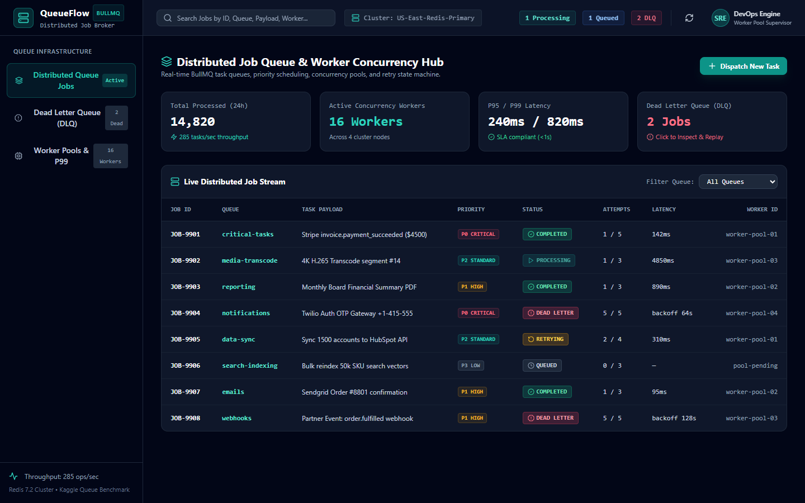
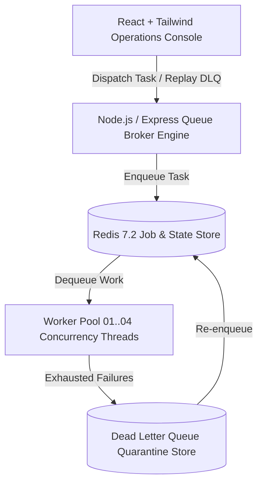

# QueueFlow — Distributed Task Queue & Worker Processing Engine

[](LICENSE)
[](https://nodejs.org/)
[](https://react.dev/)
[](https://tailwindcss.com/)
[](data/kaggle_distributed_jobs_queue_benchmark.csv)
[](https://www.docker.com/)

QueueFlow is a high-throughput distributed task queue and background job orchestration platform inspired by BullMQ and Celery architectures. Built to process asynchronous workloads at scale, it provides multi-queue priority dispatching, worker concurrency pools, exponential backoff retries, and a Dead Letter Queue (DLQ) inspector.

---

## 📸 System Dashboard & Distributed Job Stream



---

## 🌟 Key Capabilities & Standout Features

- **Multi-Queue Priority Dispatching**: Assign tasks to isolated queues (`critical-tasks`, `media-transcode`, `reporting`, `notifications`) with strict priority tiers (`CRITICAL P0`, `HIGH P1`, `STANDARD P2`, `LOW P3`).
- **Worker Concurrency Pools**: Distribute tasks across worker processes with configurable thread limits, preventing upstream rate limits and database lock contention.
- **Exponential Backoff Retries with Jitter**: Automatically retries transient network, 429 rate limit, and timeout errors with backoff intervals ($2^n$ seconds).
- **Dead Letter Queue (DLQ) Inspector & Replay**: Quarantine exhausted failed jobs, inspect raw stack traces and payloads, and re-enqueue them with a single click.
- **P95 / P99 Latency Telemetry**: Real-time observability tracking execution latency, worker memory consumption, and queue backlog depth.

---

## 🏛 Architecture Overview



---

## 📊 Dataset Benchmark

The repository includes a curated benchmark in [`data/kaggle_distributed_jobs_queue_benchmark.csv`](data/kaggle_distributed_jobs_queue_benchmark.csv) covering:
- `job_id`: Unique task identifier (e.g., `JOB-9901`)
- `queue_name`: Target queue partition
- `job_type` & `payload_summary`: Webhook delivery, video transcode, and batch PDF export
- `priority`: `CRITICAL`, `HIGH`, `STANDARD`, or `LOW`
- `status`: `QUEUED`, `PROCESSING`, `COMPLETED`, `FAILED_RETRYING`, or `DEAD_LETTER`
- `attempts` & `max_retries`: Execution attempts
- `duration_ms` & `worker_id`: Execution latency and worker instance
- `error_message` & `backoff_delay_sec`: Exception telemetry and retry delay

---

## 🔌 API Reference

| Endpoint | Method | Description |
| :--- | :--- | :--- |
| `/health` | `GET` | Health check & cluster readiness |
| `/api/v1/queues/stats` | `GET` | Aggregated throughput, P95/P99 latency, and job counts by state |
| `/api/v1/jobs` | `GET` | List all jobs (filter optional by `queue` or `status`) |
| `/api/v1/jobs` | `POST` | Dispatch a new task into the cluster |
| `/api/v1/jobs/:id/retry` | `POST` | Replay an exhausted dead-letter job back to active queue |
| `/api/v1/queues/dlq/purge` | `DELETE` | Purge all dead-letter tasks from storage |

---

## 🚀 Quickstart Guide

### Option 1: Docker Compose (Recommended)

```bash
docker-compose up --build
```
- Web Application: `http://localhost:3007`
- Backend REST API: `http://localhost:5004`

### Option 2: Local Development

#### 1. Backend Service
```bash
cd backend
npm install
npm run dev
```

#### 2. Frontend Application
```bash
cd frontend
npm install
npm run dev
```

---

## 📄 License
This project is licensed under the MIT License.
